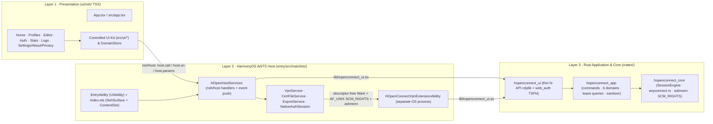

# H-OpenConnect NSH Three-Layer Architecture

H-OpenConnect uses a clean three-layer architecture built on **Native Shell (`nsh`)** and **`nsh-platform-harmonyos`**, inspired by sibling client **Paws**, while preserving H-OpenConnect's strict two-process HarmonyOS tunnel security boundary (`EntryAbility` ↔ `HOpenConnectVpnExtensionAbility`).

## Layer Overview



## 1. Presentation Layer (`ui/nsh/`)

- **Entry & Lifecycle**: [`ui/nsh/App.tsx`](../ui/nsh/App.tsx) constructs a single [`CoreClient`](../ui/nsh/src/client.tsx) inside `mount(...)` and disposes it via `cleanup(...)`.
- **Transport**: Uses first-class `nsh/host` (`host.params`, `host.call`, `host.on`) behind a `CoreTransport` interface, enabling full headless testing via `nsh test` without HarmonyOS hardware.
- **Page-Scoped Domain Observation**: [`DomainStore`](../ui/nsh/src/domain-store.ts) subscribes strictly to the active route's required subset of 6 runtime domains (`config`, `status`, `profiles`, `statistics`, `logs`, `about`), avoiding full-snapshot polling.
- **Responsive Multi-Device Shell**:
  - **Phone (`< 840pt` touch)**: 4-tab bottom navigation (`Overview`, `Connections`, `Statistics`, `Settings`) + sub-page push stacks (`Logs`, `About`, `Privacy`, `Profile Editor`).
  - **Pad (`>= 840pt` touch)**: Collapsible 64pt/232pt sidebar + split views + anchored `Popover` menus (`>= 768pt`).
  - **HarmonyOS 2-in-1 / Desktop**: Seamless top-to-bottom sidebar, 48pt integrated toolbar, pointer-scale controls, and `mod+1..4` / `mod+,` / `mod+b` shortcuts.
- **Controlled UI Components (`ui/nsh/src/ui/*`)**: Unified Paper/Graphite + Citrus Lime + Solid Stop Red token palette, dual density tiers (Touch vs Pointer), `Select` (anchored Popover on wide / BottomSheet on Phone), `ObjectMenu`, `AlertDialog`, and non-obstructing `NotificationViewport`.

## 2. ArkTS Host Layer (`entry/src/main/ets/`)

- **Standard `UIAbility`**: [`EntryAbility.ets`](../entry/src/main/ets/entryability/EntryAbility.ets) extends standard `@kit.AbilityKit` `UIAbility` (no `@ohos-rs/ability`).
- **Surface Hosting**: [`Index.ets`](../entry/src/main/ets/pages/Index.ets) mounts `NshSurface` into `ContentSlot(this.surface.content)` with no blocking startup gate.
- **Host Services (`entry/src/main/ets/host/`)**:
  - [`HOpenHostServices.ets`](../entry/src/main/ets/host/HOpenHostServices.ets): Binds `core.subscribe`, `core.query`, `core.command`, `platform.pickCertFile`, `platform.exportLog`, and `platform.openUrl` to `surface.handle(...)`, runs the revision waiter pushing `core.changed` events via `surface.send(...)`, and runs interactive SAML/SSO web auth using upstream **`NativeAuthSession`** from `@nsh/harmonyos`.
  - [`VpnService.ets`](../entry/src/main/ets/host/VpnService.ets): Preserves attempt-scoped shared memory initialization, descriptor-free bootstrap Want, AF_UNIX `SCM_RIGHTS` descriptor handoff, cooperative stop fencing, and emulator debug recovery.
  - [`CertFileService.ets`](../entry/src/main/ets/host/CertFileService.ets): System `DocumentViewPicker` certificate import into app sandbox with strict `0600` permissions.
  - [`ExportService.ets`](../entry/src/main/ets/host/ExportService.ets): System `DocumentViewPicker` log archive export.

## 3. Rust Application & Core Layers (`crates/`)

- **`crates/hopenconnect_app`**: Pure, UI-independent application boundary owning:
  - Command request dispatch (`request.rs`)
  - 6-domain revision observation & lease-fenced domain queries (`observation.rs`)
  - Lifecycle edge auto-reconnect tracking (`reconnect.rs`)
  - Zero-"VPN" user-visible text sanitization (`sanitize.rs`)
- **`crates/hopenconnect_core`**: `SessionEngine`, `anyconnect-rs` integration, `RuntimeRevisions` (`watch::channel`), 30-sample throughput ring buffer, daily log recording & archive management, ashmem IPC, and socket protection.
- **`crates/hopenconnect_ui`**: Thin N-API `cdylib` exposing `UiCommandSession`, revision waiting, `web_auth` TSFN bridge to ArkTS `NativeAuthSession`, and preserved `HOpenConnectVpnExtensionAbility` process-boundary entry points.

## Build & Verification

```sh
# 1. Rust core, app, and contract tests
cargo test --workspace

# 2. NSH type-check, production bundle sanity check, and headless UI acceptance tests
python3 ui/nsh/run-tests.py

# 3. Full HarmonyOS arm64-v8a NSH + native OpenConnect + ArkTS HAP build
./scripts/package-hap.sh
```
